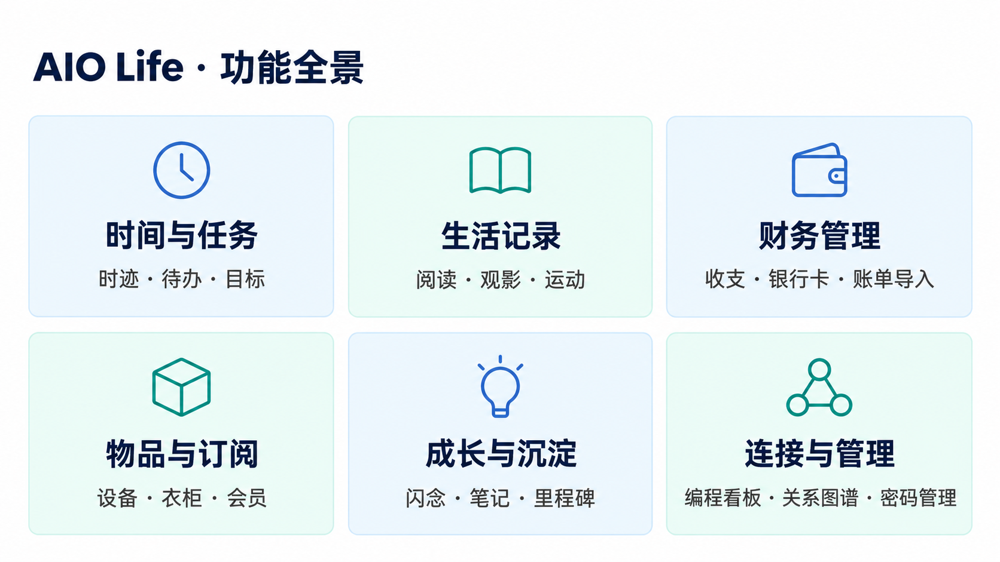
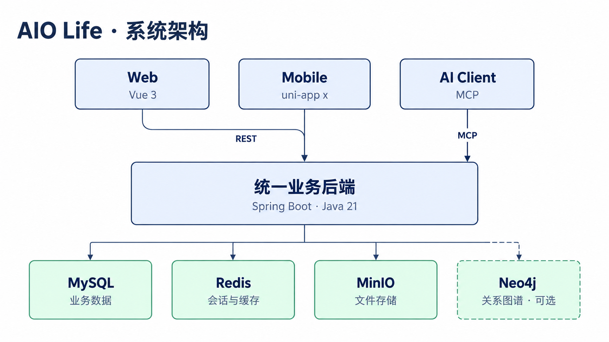

# AIO Life

All-in-One 人生管理系统，围绕时迹、目标与待办，管理阅读、运动、财务、物品、会员及其他生活记录，提供首页看板、统计和数据导出。

项目仍在开发中。本仓库维护跨端需求、技术方案、编排配置和开发脚本；各客户端与服务使用独立 Git 仓库。先运行业务后端，再按需要启动 Web、移动端或附加服务。

## 仓库与文档

| 仓库 | 职责 | 开发入口 |
| --- | --- | --- |
| [aio-life-front](https://github.com/lys1313013/aio-life-front) | Web 客户端：Vue Vben Admin、Ant Design Vue、pnpm monorepo | [README](https://github.com/lys1313013/aio-life-front/blob/main/README.md)、[开发规范](https://github.com/lys1313013/aio-life-front/blob/main/AGENTS.md) |
| [aio-life-server](https://github.com/lys1313013/aio-life-server) | 统一业务 API：Spring Boot、Java 21、MyBatis-Plus、MySQL、Redis、MinIO | [README](https://github.com/lys1313013/aio-life-server/blob/main/README.md)、[开发规范](https://github.com/lys1313013/aio-life-server/blob/main/AGENTS.md) |
| [aio-life-mobile](https://github.com/lys1313013/aio-life-mobile) | uni-app x Vapor，H5、微信小程序与 App | [README](https://github.com/lys1313013/aio-life-mobile/blob/main/README.md)、[开发规范](https://github.com/lys1313013/aio-life-mobile/blob/main/AGENTS.md) |
| [aio-life-query](https://github.com/lys1313013/aio-life-query) | Java 21、Hasura v3、MySQL Connector，只读查询 | [README](https://github.com/lys1313013/aio-life-query/blob/main/README.md) |
| [aio-life-chrome-plugin](https://github.com/lys1313013/aio-life-chrome-plugin) | B 站进度、豆瓣书影与购物页面采集 | [README](https://github.com/lys1313013/aio-life-chrome-plugin/blob/main/README.md) |

查找需求、API 契约、上线步骤与历史验收，先看[文档目录](docs/README.md)。跨仓库约定见 [AGENTS.md](AGENTS.md)。各端运行时版本以自身配置和 README 为准；数据库当前结构由冻结基线与后续 Flyway 版本迁移共同定义，独立迁移入口及已有库接入流程见[数据库初始化与验证](aio-life-server/docs/数据库初始化与验证.md)。

## 初始化与启动

准备 Git 与 GitHub SSH 授权、JDK 21、Maven、Node.js 和相应包管理器。Web 使用仓库 `packageManager` 固定的 pnpm，移动端使用 npm；Python 3 用于跨端契约脚本，GitHub CLI 用于统一推送。运行查询服务、镜像编排或容器测试时另需 Docker。

```bash
git clone https://github.com/lys1313013/aio-life.git
cd aio-life
./scripts/setup-repositories.sh
```

脚本通过 SSH 克隆 Web、后端和移动端。查询服务与浏览器插件按上表单独克隆到同名目录；初始化和更新脚本不包含它们。主仓库不跟踪子仓库文件或提交指针。当前 `aio-life-mac/` 仅为空目录，尚无可启动项目。

先按[后端 README](https://github.com/lys1313013/aio-life-server/blob/main/README.md)准备数据库、Redis、环境变量及业务库结构，再在独立终端分别启动。以下命令均从主仓库目录开始执行：

```bash
# 后端：API 45678，context-path /api；管理端点 45679
cd aio-life-server
mvn spring-boot:run
```

```bash
# Web：Node 版本见 Web README，Corepack 按 packageManager 选择 pnpm
cd aio-life-front
corepack enable
pnpm install --frozen-lockfile
pnpm run dev:antd
```

```bash
# 移动端 H5：5180，默认代理本地后端 45678
cd aio-life-mobile
npm ci
# 仅首次创建；随后按需编辑 .env.local
test -f .env.local || cp .env.example .env.local
npm run dev
```

默认本地入口如下；端口被覆盖时以启动日志为准：

| 服务 | 地址 | 说明 |
| --- | --- | --- |
| Web | <http://localhost:5666> | 开发代理将 `/api` 转发到本地业务后端 |
| 移动端 H5 | <http://localhost:5180> | `AIO_API_PROXY_TARGET` 可覆盖后端代理目标 |
| 业务 API | <http://localhost:45678/api> | 供客户端、插件及 MCP 接入 |
| 后端健康检查 | <http://localhost:45679/actuator/health> | 独立管理端口，健康响应不代表业务验收通过 |

敏感配置通过 `AIO_LIFE_*` 环境变量注入。Maven 不自动加载 `.env`；根目录 [.env.example](.env.example) 仅为配置参考，完整必填项见后端 README。移动端 `VITE_*` 配置会进入客户端包，不能存放密钥；真机访问开发后端需使用设备可达的地址。微信上传、App 工具链及平台验证见各端 README。

## AI Skill

[AIO Life API Skill](skills/aio-life-api/SKILL.md) 在本仓库统一维护，通过在线契约渐进式发现并调用接口。只保存通用规则、公开接口信息和 UI 元数据；Token、私有服务地址、个人业务数据与本机配置均留在仓库外，通过运行环境提供。

本地使用符号链接引用项目版本，无需复制或同步文件。在主仓库目录首次安装：

```bash
mkdir -p "${CODEX_HOME:-$HOME/.codex}/skills"
ln -s "$(pwd)/skills/aio-life-api" "${CODEX_HOME:-$HOME/.codex}/skills/aio-life-api"
```

已有同名目录时先核对并迁移其中需要保留的通用内容，再替换为符号链接，不强制覆盖。以后只编辑仓库内版本；移动项目目录后需更新本地链接。凭据通过 `AIO_LIFE_API_TOKEN` 提供，私有部署地址通过 `AIO_LIFE_API_BASE_URL` 提供，不写入 Skill。

## 镜像编排

根目录 [docker-compose.yml](docker-compose.yml) 运行已发布的 Web 和后端镜像，Web 映射到 `8080`，后端映射到 `45678` 和 `45679`。它不从本地源码构建，也不包含 MySQL、Redis、MinIO 或数据库初始化；依赖服务和库结构须先准备完成。

在本地 `.env` 中补齐后端配置，再使用 `docker compose up -d`。依赖地址必须能从容器访问，不能直接照抄示例中的 `localhost`；镜像仓库需要相应拉取权限。部署时将管理端口 `45679` 限制在受信网络，具体镜像构建和发布步骤见各端 README。

### 可选接入 SkyWalking

后端两条镜像构建路径均内置固定版本的完整 Java Agent，默认不加载。发布并拉取包含此改动的镜像、启动 SkyWalking 后，使用 [docker-compose.skywalking.yml](docker-compose.skywalking.yml) 启用 Agent：

```bash
docker compose -f docker-compose.yml -f docker-compose.skywalking.yml pull backend
docker compose -f docker-compose.yml -f docker-compose.skywalking.yml up -d --no-deps backend
```

这会重建后端容器。配置默认使用已有的 `skywalking_default` 网络、`skywalking-oap:11800` 采集地址和 `aio-life-server` 服务名；可在 `.env` 覆盖 `SKYWALKING_NETWORK`、`SW_AGENT_COLLECTOR_BACKEND_SERVICES`、`SW_AGENT_NAME`。它保留原 `aio-life` 网络，并将 `JAVA_TOOL_OPTIONS` 与 Agent 参数合并；已有该变量时不要重复填写同一个 `-javaagent`。`SW_AGENT_SAMPLE=-1` 表示不限制每三秒采样数量；OAP 也须设置为 100% 采样，7 天保留期在存储端设置。

Agent 已在镜像内，无需宿主机目录挂载。启用后的更新继续使用上述两份 Compose 文件；停用时运行 `docker compose -f docker-compose.yml up -d --no-deps backend`，并确保 `.env` 没有另行设置 Agent 启动参数。基础部署不依赖 SkyWalking 网络。日志关联及验证方法见[后端部署说明](aio-life-server/README.md#skywalking-java-agent)。

## 更新与交付

```bash
./scripts/pull-latest-main.sh
```

此入口只更新三个业务子仓库，要求它们处于 `main` 且工作区干净，使用 `git pull --ff-only`。主仓库自身、查询服务和插件需在各自仓库更新；不要为拉取代码丢弃未提交修改。

后端请求 DTO 或 GET 参数调整后，从主仓库生成并检查两端契约（需已安装 Web 依赖）：

```bash
python3 scripts/generate-api-contracts.py
python3 scripts/generate-api-contracts.py --check
```

先在所属仓库审查并提交改动，确认参与推送的仓库位于 `main`，再从主仓库执行：

```bash
python3 scripts/push-repositories.py
```

入口先快进更新参与仓库、生成并自动提交 Web 和移动端契约，再推送后端、Web、移动端及主仓库；全部成功后检查契约并触发只读联合 CI。需要 Web 依赖、Git 授权和已登录的 GitHub CLI，不会自动提交业务修改，也不处理查询服务或插件。明确跳过 Git hooks 时使用 `--skip-hooks`，详见[统一推送前提与失败恢复](docs/API参数规范.md#本地统一推送与联合检查)。

日常验证按改动范围在所属仓库执行，命令见各端 README。纯文档改动检查差异和引用，无需业务测试或构建；本地检查、CI、目标环境部署和设备验收分别记录结果。

## 功能全景



## 系统架构



查询服务目前开放时迹、运动、阅读、影视、视频、演出六个数据集，提供 REST、GraphQL HTTP 和 MCP，支持时迹分类关系；通过原后端校验 Token／API Key。具体范围及部署限制见[查询服务说明](https://github.com/lys1313013/aio-life-query/blob/main/README.md)，图示不代表目标环境已部署全部可选服务。

## 目录结构

```text
aio-life/
├── aio-life-front/          # 独立 Web 仓库
├── aio-life-server/         # 独立后端仓库
├── aio-life-mobile/         # 独立移动端仓库
├── aio-life-query/          # 可选只读查询服务，单独克隆
├── aio-life-chrome-plugin/  # 可选浏览器插件，单独克隆
├── skills/aio-life-api/    # API Skill 唯一维护源，本地通过符号链接引用
├── docs/                   # 跨端需求、方案与历史记录
│   ├── design/             # 设计稿、设计说明与生成提示词
│   ├── prototypes/         # 交互原型及配套预览
│   └── reviews/            # 按日期归档的审查与验收证据
└── scripts/                # 初始化、更新、契约生成与统一推送
```

主仓库没有 Node 应用或依赖安装步骤；契约脚本使用 Web 仓库安装的格式化工具。`output/`、`artifacts/` 和工具运行状态是忽略的本机产物；需要交付的资料先移入上述文档目录，再补充索引、日期与适用范围。
