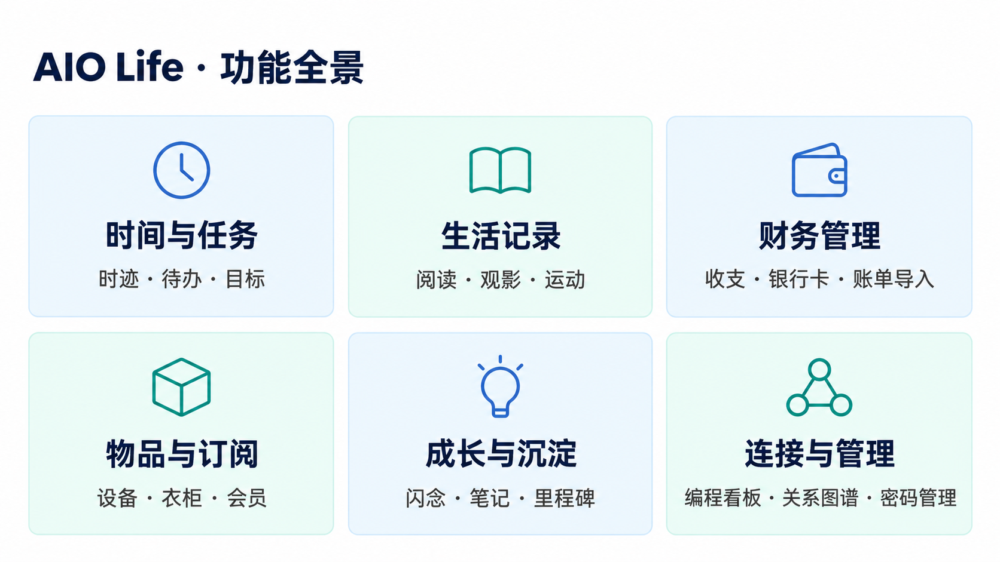
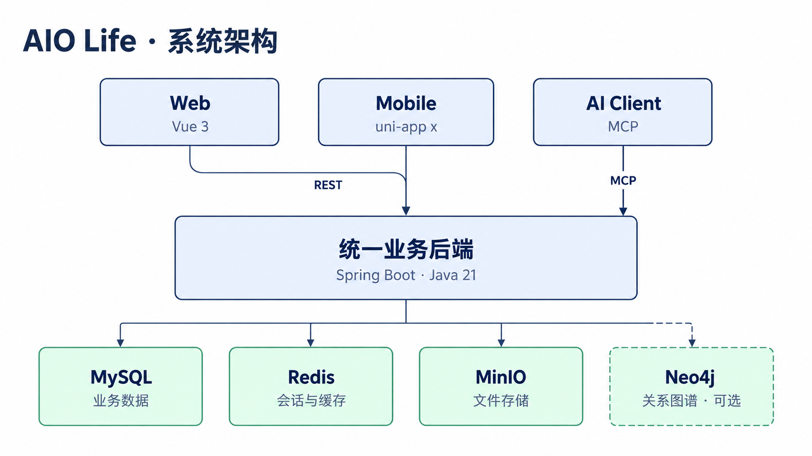

# AIO Life

All-in-One 人生管理系统，围绕时迹、目标与待办，管理阅读、运动、财务、物品、会员及其他生活记录，提供首页看板、统计和数据导出。

项目仍在开发中。本仓库维护跨端需求、技术方案、编排配置和开发脚本；各客户端与服务使用独立 Git 仓库。先运行业务后端，再按需要启动 Web、移动端或附加服务。

## 仓库与文档

| 仓库 | 职责 | 开发入口 |
| --- | --- | --- |
| [aio-life-front](https://github.com/lys1313013/aio-life-front) | Web 客户端：Vue Vben Admin、Ant Design Vue、pnpm monorepo | [README](https://github.com/lys1313013/aio-life-front/blob/main/README.md)、[开发规范](https://github.com/lys1313013/aio-life-front/blob/main/AGENTS.md) |
| [aio-life-server](https://github.com/lys1313013/aio-life-server) | 统一业务 API：Spring Boot、Java 21、MyBatis-Plus、PostgreSQL、Redis、MinIO | [README](https://github.com/lys1313013/aio-life-server/blob/main/README.md)、[开发规范](https://github.com/lys1313013/aio-life-server/blob/main/AGENTS.md) |
| [aio-life-mobile](https://github.com/lys1313013/aio-life-mobile) | uni-app x Vapor，H5、微信小程序与 App | [README](https://github.com/lys1313013/aio-life-mobile/blob/main/README.md)、[开发规范](https://github.com/lys1313013/aio-life-mobile/blob/main/AGENTS.md) |
| [aio-life-query](https://github.com/lys1313013/aio-life-query) | Java 21、Hasura v3、PostgreSQL Connector，只读查询 | [README](https://github.com/lys1313013/aio-life-query/blob/main/README.md) |
| [aio-life-chrome-plugin](https://github.com/lys1313013/aio-life-chrome-plugin) | B 站进度、豆瓣书影与购物页面采集 | [README](https://github.com/lys1313013/aio-life-chrome-plugin/blob/main/README.md) |

查找需求、API 契约、上线步骤与历史验收，先看[文档目录](docs/README.md)。跨仓库约定见 [AGENTS.md](AGENTS.md)。各端运行时版本以自身配置和 README 为准；数据库当前结构由冻结基线与后续 Flyway 版本迁移共同定义，独立迁移入口及已有库接入流程见[数据库初始化与验证](aio-life-server/docs/数据库初始化与验证.md)。

## 初始化与启动

准备 Git 与 GitHub SSH 授权、JDK 21、Maven、Node.js 和相应包管理器。Web 使用仓库 `packageManager` 固定的 pnpm，移动端使用 npm；Python 3 用于跨端契约脚本，GitHub CLI 用于统一推送。运行查询服务、镜像编排或容器测试时另需 Docker。

```bash
git clone https://github.com/lys1313013/aio-life.git
cd aio-life
./scripts/setup-repositories.sh
```

脚本通过 SSH 克隆 Web、后端和移动端。查询服务与浏览器插件按上表单独克隆到同名目录；初始化和更新脚本不包含它们。主仓库不跟踪子仓库文件或提交指针。当前 `aio-life-mac/` 仅为空目录，尚无可启动项目。

先按[后端 README](https://github.com/lys1313013/aio-life-server/blob/main/README.md)准备数据库、Redis、环境变量及业务库结构，再在独立终端分别启动。以下命令均从主仓库目录开始执行：

```bash
# 后端：API 45678，context-path /api；管理端点 45679
cd aio-life-server
mvn spring-boot:run
```

```bash
# Web：Node 版本见 Web README，Corepack 按 packageManager 选择 pnpm
cd aio-life-front
corepack enable
pnpm install --frozen-lockfile
pnpm run dev:antd
```

```bash
# 移动端 H5：5180，默认代理本地后端 45678
cd aio-life-mobile
npm ci
# 仅首次创建；随后按需编辑 .env.local
test -f .env.local || cp .env.example .env.local
npm run dev
```

默认本地入口如下；端口被覆盖时以启动日志为准：

| 服务 | 地址 | 说明 |
| --- | --- | --- |
| Web | <http://localhost:5666> | 开发代理将 `/api` 转发到本地业务后端 |
| 移动端 H5 | <http://localhost:5180> | `AIO_API_PROXY_TARGET` 可覆盖后端代理目标 |
| 业务 API | <http://localhost:45678/api> | 供客户端、插件及 MCP 接入 |
| 后端健康检查 | <http://localhost:45679/actuator/health> | 独立管理端口，健康响应不代表业务验收通过 |

敏感配置通过 `AIO_LIFE_*` 环境变量注入。Maven 不自动加载 `.env`；根目录 [.env.example](.env.example) 仅为配置参考，完整必填项见后端 README。移动端 `VITE_*` 配置会进入客户端包，不能存放密钥；真机访问开发后端需使用设备可达的地址。微信上传、App 工具链及平台验证见各端 README。

## AI Skill

[AIO Life API Skill](skills/aio-life-api/SKILL.md) 在本仓库统一维护，通过在线契约渐进式发现并调用接口。只保存通用规则、公开接口信息和 UI 元数据；Token、私有服务地址、个人业务数据与本机配置均留在仓库外，通过运行环境提供。

本地使用符号链接引用项目版本，无需复制或同步文件。在主仓库目录首次安装：

```bash
mkdir -p "${CODEX_HOME:-$HOME/.codex}/skills"
ln -s "$(pwd)/skills/aio-life-api" "${CODEX_HOME:-$HOME/.codex}/skills/aio-life-api"
```

已有同名目录时先核对并迁移其中需要保留的通用内容，再替换为符号链接，不强制覆盖。以后只编辑仓库内版本；移动项目目录后需更新本地链接。凭据通过 `AIO_LIFE_API_TOKEN` 提供，私有部署地址通过 `AIO_LIFE_API_BASE_URL` 提供，不写入 Skill。

## 镜像编排

根目录 [docker-compose.yml](docker-compose.yml) 运行已发布的 Web 和后端镜像，Web 映射到 `8080`，后端映射到 `45678` 和 `45679`。它不从本地源码构建，也不包含 PostgreSQL、Redis、MinIO 或数据库初始化；依赖服务和库结构须先准备完成。

在本地 `.env` 中补齐后端配置，再使用 `docker compose up -d`。依赖地址必须能从容器访问，不能直接照抄示例中的 `localhost`；镜像仓库需要相应拉取权限。部署时将管理端口 `45679` 限制在受信网络，具体镜像构建和发布步骤见各端 README。

### 独立启动 Query

[docker-compose-query.yml](docker-compose-query.yml) 使用独立项目名 `aio-life-query`，单独管理以下三个容器，业务后端、PostgreSQL 和 Redis 使用现有部署：

| 服务 | 职责 |
| --- | --- |
| `aio-life-query` | Query 的 REST、GraphQL HTTP 和 MCP 入口，调用现有业务后端鉴权 |
| `hasura` | 配套 Hasura v3 引擎，执行模型及行列权限配置 |
| `postgresql-connector` | 独立 HTTP 服务，将 Hasura 查询计划转换为 SQL，使用专用只读账号连接已有 PostgreSQL 18+ |

调用链为 `aio-life-query → Hasura v3 → PostgreSQL Connector → PostgreSQL`。当前使用的 Hasura v3 通过 NDC 协议调用 Connector，Connector 需要独立运行。网关仍使用 Redis 保存一次性执行票据、限流和并发状态，但本文件不创建 Redis 容器，默认复用 `AIO_LIFE_REDIS_HOST/PORT/PASSWORD`；需要覆盖时设置 `AIO_QUERY_REDIS_HOST/PORT/PASSWORD`。当前 Query 键使用 `aioQuery:` 前缀，不读取后端的登录会话键；用户身份仍由业务后端鉴权接口判定。

准备步骤：

1. 先启动现有业务后端及其依赖，确保主 Compose 创建的 `aio-life` 网络存在。Query 网关默认通过 `http://backend:45678/api/internal/query/access/check-token` 鉴权；Web 通过同一网络中的 `aio-life-query:45680` 访问 Query。已有网络名称不同可设置 `AIO_QUERY_BACKEND_NETWORK`。若后端位于其他主机，需配置实际内网 `AIO_QUERY_ACCESS_URL` 并预先创建 Query 网关与代理使用的共享网络。
2. 在根目录 `.env` 中启用并填写 [.env.example](.env.example) 的 Query 配置，并确保已有 Redis 地址能从网关容器访问。后端设置 `AIO_LIFE_QUERY_ACCESS_ENABLED=true`，其服务密钥必须与 `AIO_QUERY_SERVICE_KEY` 一致；需要目标自动进度时配置 `AIO_LIFE_GOAL_QUERY_URL=http://aio-life-query:45680/graphql`。后端配置变化后，用原主 Compose 更新后端容器。
3. 按 [Query 只读账号示例](aio-life-query/deploy/readonly-account.sql.example) 准备已有数据库的列级 SELECT 权限，配置容器可达的只读 JDBC URL。准备已验证的 `AIO_QUERY_ENGINE_IMAGE`、`AIO_QUERY_CONNECTOR_IMAGE`；默认 Connector 镜像是本机镜像，网关默认使用 ACR 的 `aio-life-query:latest`。现有 CI 仅发布网关，不能据此认为引擎和 Connector 镜像已发布。镜像构建方式与发布边界见 [Query 部署说明](aio-life-query/docs/Docker与GitHubActions.md#compose-使用发布镜像)。
4. 克隆配套 `aio-life-query` 仓库后生成元数据。生成器不会自动加载 `.env`：先在当前终端安全注入与 `.env` 相同的 `AIO_QUERY_WEBHOOK_KEY`、`AIO_QUERY_CONNECTOR_KEY`，再执行下方命令。保持默认内部地址 `http://postgresql-connector:8080`、`http://aio-life-query:45680/internal/hasura/auth`；若当前终端已有 `AIO_QUERY_CONNECTOR_URL`、`AIO_QUERY_AUTH_WEBHOOK_URL`，须核对其值。将生成账号的 `id -g` 输出填入 `.env` 的 `AIO_QUERY_CONFIG_GID`。

```bash
# 从主仓库目录执行；需要 Python 3 和配套 Query 源码。
python3 aio-life-query/scripts/build_metadata.py
docker compose -f docker-compose-query.yml config --quiet
docker compose -f docker-compose-query.yml up -d --no-build
docker compose -f docker-compose-query.yml ps
```

Query 不声明对 Hasura 的 Compose 启动依赖，可分别启动和更新：

```bash
# 启动 Hasura 及其 PostgreSQL Connector，不启动 Query。
docker compose -f docker-compose-query.yml up -d --no-build hasura
# 只启动或更新 Query，不自动启动 Hasura。
docker compose -f docker-compose-query.yml up -d --no-build aio-life-query
```

这仅分开容器启动操作，查询执行仍依赖可用的 Hasura。默认使用同一 Compose 网络中的 `http://hasura:3000/graphql`；另行部署时可用 `AIO_QUERY_HASURA_URL` 覆盖，同时确保 Hasura 能访问元数据中的 Query 鉴权回调地址。

日常仅更新 Query 镜像时，运行 [scripts/update-query.sh](scripts/update-query.sh)：

```bash
./scripts/update-query.sh
```

脚本自动进入主仓库目录，检查 Compose 配置后，仅执行 `pull aio-life-query` 和 `up -d --no-deps --no-build --pull never aio-life-query`，最后显示该服务状态。镜像或配置变化时 Compose 会重建 Query 容器；未变化时保留现有容器。配置检查或镜像拉取失败时立即停止，不进入更新步骤。已提前导入或在部署主机准备本地镜像时，使用 `./scripts/update-query.sh --no-pull`；缺少本地镜像会明确失败，不会自动拉取。更新过程中不执行 `down`，不拉取、停止或重建 Hasura 和 Connector；若执行整套 `docker compose -f docker-compose-query.yml down`，仍会停止它们。该脚本适用于网关镜像更新，模型、关系或内部密钥变化仍须按下文同步元数据与相关服务。

默认挂载 `aio-life-query/.cache/hasura/`，目录缺失时拒绝启动，不会自动创建空配置目录；远端部署可设置 `AIO_QUERY_METADATA_DIRECTORY` 指向安全传输后的元数据目录，无需保留源码。目录须允许 `AIO_QUERY_CONFIG_GID` 读取，生成文件含内部密钥，不能提交。字段、关系或相关密钥变化后须重新生成并部署匹配的配置；本文件与 Query 仓库的 `deploy/compose.yml` 二选一使用，不要同时运行。

仅网关端口 `45680` 绑定宿主回环地址，Hasura 和 Connector 不发布宿主端口。Web 的 `/query-api/api/v1/` 可通过现有 Nginx 转发；外部 AI/MCP 使用 HTTPS 代理，仅转发 `/api/v1/`、`/graphql`、`/mcp`，内部鉴权端点不作为公网入口。网关审计保存在独立 `audit` 卷；Redis 的部署和持久化配置由现有实例管理。

### SkyWalking（Compose 默认启用）

后端两条镜像构建路径均内置固定版本的完整 Java Agent。[docker-compose.yml](docker-compose.yml) 已包含 Agent 启用参数和网络配置，部署只使用这一份文件。先启动 SkyWalking，确保其 Docker 网络和 OAP 已就绪，再发布并拉取包含 Agent 的后端镜像：

```bash
docker compose pull backend
docker compose up -d --no-deps backend
```

这会重建后端容器，Web 容器无需重建；整套服务也可直接执行 `docker compose up -d`。后端同时加入原 `aio-life` 网络和已有的 `skywalking_default` 网络，默认向 `skywalking-oap:11800` 上报，控制台服务名为 `aio-life-server`。可在 `.env` 覆盖 `SKYWALKING_NETWORK`、`SW_AGENT_COLLECTOR_BACKEND_SERVICES`、`SW_AGENT_NAME`。外部网络必须已存在，否则 Compose 启动会失败；容器内的 `127.0.0.1` 不能用来连接另一个容器中的 OAP。

Compose 会将已有的 `JAVA_TOOL_OPTIONS` 与 Agent 参数合并，不要在 `.env` 中重复填写同一个 `-javaagent`。`SW_AGENT_SAMPLE=-1` 表示不限制每三秒采样数量；OAP 也须设置为 100% 采样，7 天保留期在存储端设置。Agent 已在镜像内，无需宿主机目录挂载，Agent 日志通过 `docker logs aio-life-server` 查看。镜像单独运行时仍需手动启用 Agent；使用本仓库 Compose 时自动启用。日志关联及验证方法见[后端部署说明](aio-life-server/README.md#skywalking-java-agent)。

## 更新与交付

```bash
./scripts/pull-latest-main.sh
```

此入口只更新三个业务子仓库，要求它们处于 `main` 且工作区干净，使用 `git pull --ff-only`。主仓库自身、查询服务和插件需在各自仓库更新；不要为拉取代码丢弃未提交修改。

后端请求 DTO 或 GET 参数调整后，按 [API 参数规范](docs/API参数规范.md#契约生成与验证)生成并检查两端契约；不要手改生成文件。先在所属仓库审查并提交业务改动，再从主仓库使用统一交付入口：

```bash
python3 scripts/push-repositories.py
```

入口覆盖后端、Web、移动端、主仓库，以及本地存在的独立 Query 仓库；浏览器插件单独交付。参与条件、依赖、执行顺序、`--skip-hooks` 和失败恢复统一维护在 [API 参数规范](docs/API参数规范.md#本地统一推送与联合检查)。

日常验证按改动范围在所属仓库执行，命令见各端 README。纯文档改动检查差异和引用，无需业务测试或构建；本地检查、CI、目标环境部署和设备验收分别记录结果。

## 功能全景



## 系统架构



> 架构图为 2026-10-22 生成版本，存储层仍标注迁移前的 MySQL；当前实现使用 PostgreSQL 18+，重新生成提示词见 [docs/architecture/prompts.json](docs/architecture/prompts.json)。

查询服务目前开放时迹、运动、阅读、影视、视频、活动及月收入七个数据集，提供 REST、GraphQL HTTP 和 MCP，支持时迹分类关系；通过原后端校验 Token／API Key。具体范围及部署限制见[查询服务说明](https://github.com/lys1313013/aio-life-query/blob/main/README.md)，图示不代表目标环境已部署全部可选服务。

## 目录结构

```text
aio-life/
├── aio-life-front/          # 独立 Web 仓库
├── aio-life-server/         # 独立后端仓库
├── aio-life-mobile/         # 独立移动端仓库
├── aio-life-query/          # 可选只读查询服务，单独克隆
├── aio-life-chrome-plugin/  # 可选浏览器插件，单独克隆
├── skills/aio-life-api/    # API Skill 唯一维护源，本地通过符号链接引用
├── docs/                   # 跨端需求、方案与历史记录
│   ├── design/             # 技术设计与待实施方案
│   ├── prototypes/         # 当前页面参考与原型维护约定
│   └── reviews/            # 按日期归档的审查与验收证据
└── scripts/                # 初始化、更新、契约生成与统一推送
```

主仓库没有 Node 应用或依赖安装步骤；契约脚本使用 Web 仓库安装的格式化工具。`output/`、`artifacts/` 和工具运行状态是忽略的本机产物；需要交付的资料先移入上述文档目录，再补充索引、日期与适用范围。
