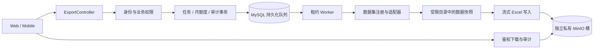

# 个人数据导出：需求与实现说明

更新：2026-10-28。状态：已实现源码，导出默认开启；目标环境以实际部署验收为准。本文描述当前实现；容量参数是工程保护值，不是压测结论。

用户在 Web「个人中心 → 数据导出」或移动端「我 → 数据导出」申请本人数据，后台生成 Excel，再通过登录鉴权下载。**每个用户每个自然月最多 5 次，不设每日额度**；全部与自选范围共享额度。

## 1. 范围与用户流程

默认选择目录内可用或需要解锁的数据集，用户可以取消选择。界面明确展示不可用项、排除说明、剩余次数、历史任务和文件到期时间。当前不提供日期筛选、敏感备份档位或恢复导入。

1. 读取目录和月度余额，默认不执行全业务 COUNT。
2. 生成前验证二级密码；未设置二级密码时验证登录密码。没有密码时先在账户安全设置密码，当前不提供邮箱验证码核验。
3. 已选择的菜单及祖先菜单均须解锁；身份核验不会自动解锁业务。个人中心本身的菜单锁也生效。
4. 服务端签发有效期 5 分钟的一次性票据，绑定用户、会话、凭据状态、用途、范围版本；下载票据还绑定任务。
5. 以幂等键创建任务，返回排队状态。网络错误重试沿用相同键，不重复扣次。
6. 页面可见且有活动任务时每 5 秒刷新。离页或切换账号时隔离旧响应。移动端历史触底加载，失败重试原页。
7. 下载再次核验身份与权限。文件保留 24 小时，可主动删除；大数据分卷 ZIP 在微信端提示去 Web 下载同一任务。

普通导出包含当前持久化、归属于本人且当前有权访问的业务字段。它不是完整账号备份：**不含登录凭据、API Key 原值、第三方 Cookie/Token、银行卡密文/指纹、密码库秘密字段、附件原件、逻辑删除记录、历史停用模块、内部运行流水**。

数据清单的唯一来源：

- [datasets.json](../../aio-life-server/src/main/resources/export/datasets.json)：48 个 MySQL 数据集，显式列名、类型、菜单与本人归属；覆盖资料偏好、时迹待办目标、财务设备、阅读内容、衣柜会员、测评足迹、反馈消息、通知绑定及密码库元数据。
- [excluded-columns.json](../../aio-life-server/src/main/resources/export/excluded-columns.json)：每个已接入表未导出字段的明确排除原因。
- [excluded-tables.json](../../aio-life-server/src/main/resources/export/excluded-tables.json)：公共目录、内部运行、安全、历史停用表及导出控制表的分类。
- [AttachmentDatasets](../../aio-life-server/src/main/java/top/aiolife/export/dataset/AttachmentDatasets.java)：按有效业务记录归属及附件创建人限定的附件元数据；不输出内部对象路径。当前覆盖衣柜、反馈、影视、荣誉、阅读、演出、设备、银行卡封面及视频封面，不含头像及回复附件。
- [RelationshipDatasets](../../aio-life-server/src/main/java/top/aiolife/export/dataset/RelationshipDatasets.java)：可选 Neo4j 人物和关系。关闭或不可授权时目录标为不可用；运行中故障则整单失败，不伪装成空数据。关系及两端人物均检查本人归属。

历史文章/标注数据集仍登记字段，但没有当前有效业务菜单时不可选。公共字典和平台仅保留业务中的引用 ID，不导出公共目录。本人导出历史由专用列表接口查看，不递归包含在 Excel 中。模块状态目前为 AVAILABLE / LOCKED / UNAVAILABLE，未细分所有不可用原因。用户主动隐藏菜单不影响数据范围。

新增物理表或已有表新增字段时，清单测试要求明确登记或排除；禁止默认反射实体所有字段。

## 2. 抽象与依赖

| 组件 | 单一职责 |
| --- | --- |
| `ExportDataset` / `ExportDatasetContributor` | 提供稳定键、字段、菜单、可用性及按本人身份游标读取 |
| `ExportDatasetRegistry` | 注册白名单数据集、校验重复键、计算目录版本、解析所选范围 |
| `SqlExportDataset` / `ExportDatasetSql` | 共用 SQL 适配器；表、列、关联只来自发布配置，运行时值全部参数绑定 |
| `ExportAccessGuard` | 普通登录、当前角色、完整菜单祖先、二级锁、账户存在和会话存续校验 |
| `ExportAuthorizationService` | 密码核验及一次性票据签发、消费 |
| `ExportQuotaService` | 按月计算已预占或消耗次数；上限不能配置超过 5 |
| `ExportJobService` | 短事务内处理幂等、建单、领取、终态、退额与取消 |
| `ExportSnapshotService` | 同一 MySQL 只读 RR 事务捕获白名单数据；不在此事务内打包或上传 |
| `ExcelExportWriter` / `ExportCellWriter` | 格式、分 Sheet / 分卷、类型和长文本保真，不负责业务查询和鉴权 |
| `ExportArtifactStore` | 私有文件存储边界；当前实现为独立 MinIO 桶 |
| `ExportWorker` | 执行持久化任务、心跳、发布和残留清理 |
| `ExportAuditRecorder` | 关键事件同事务记录，拒绝和传输结果独立记录 |

接口和实现按领域放在 `top.aiolife.export`，数据访问在 Mapper 内；响应使用固定 VO 与 MapStruct，内部对象键、会话摘要和票据不返回前端。扩展业务优先增加目录定义；非 MySQL 数据源通过 Contributor 注册，任务引擎不增加业务分支。

## 3. 权限边界

- 普通会话之外的 API Key、临时身份切换不能进入个人导出。后台读取始终显式传递申请用户 ID，不依赖线程登录态。
- 任务列表、详情、取消、删除、下载全部按当前用户归属检查。管理员身份不赋予他人任务权限。
- 限定每张表的 owner 字段；子表使用父表 EXISTS 归属检查；设备费用、银行卡标签等关联的两端均校验。本人反馈的用户可见回复可导出，但不携带其他用户 ID。
- 菜单和祖先必须在同一端完整启用、满足角色；Web 或移动端至少一端符合即可。目录不接受客户端平台、表名、字段名、SQL 或 userId。
- 快照每批次、打包检查点和发布前重新检查会话、账户凭据状态、权限、锁、取消、租约和截止时间。权限查询使用独立事务，避免被业务快照遮蔽。
- 下载开始前及传输中每约 2 秒检查当前会话和权限；到期或被删除文件不可读。已发送字节无法追回。
- 不返回预签名链接，不注册到普通 file 表，不复用公开桶。GET 下载凭证仅通过请求头；HEAD 不消费票据或下载次数；暂不接受 Range。
- 下载错误在未写出文件时清除附件响应头，再返回错误 JSON；客户端验证响应状态和媒体类型。

## 4. 月额度与状态机

按 `Asia/Shanghai` 自然月，月初 00:00 重置。每月最多 5 次；同一天可以完成全部 5 次。额度以数据库任务的 `quota_month`、`quota_charged` 为账本，不依赖 Redis 持久化计数。

| 场景 | 计次 |
| --- | --- |
| 申请成功入队 | 原子预占 1 次 |
| 同幂等键同范围重放 | 返回原任务，不重复预占 |
| 同幂等键不同范围 | 拒绝 |
| 系统失败、超时或权限撤销导致失败 | 退回原月份预占，不删除任务或审计 |
| 尚未开始就取消 | 退额 |
| 已经开始后主动取消 | 计次，包括崩溃后重新排队的任务 |
| 成功生成、文件过期、主动删除 | 计次，不返还 |
| 再次下载 | 不消耗生成次数 |

建单在同一事务中锁全局控制行和用户行，检查活动任务、队列和月额度，消费票据，写任务和审计。月桶与申请时间取同一时刻，避免跨月读写不一致。关键审计失败会回滚建单及预占。

每用户最多 1 个活动任务；全局最多 2 个执行、100 个活动任务。Redis 仅做短时防刷（申请用户/IP、核验失败、下载频率）和同用户下载互斥，**没有日生成计数**。每个成品最多 20 次下载尝试。

任务状态：`QUEUED → RUNNING → SUCCEEDED / FAILED / CANCELLED`。每次领取生成新 lease token，租约 90 秒，每 20 秒续租；旧执行者不能覆盖新结果。失联任务可在总时限内重新领取，最多 3 次尝试；普通处理异常直接失败退额。默认总时限 15 分钟。

上传与数据库发布之间不宣称分布式原子事务：只有数据库确认成功的对象可下载；上传后发布失败的对象立即尝试删除，后台也会回收超过 1 小时且无任务引用的孤儿对象、临时工作目录。文件逻辑撤销立即生效，物理删除可重试。

## 5. Excel 与一致性

- 普通数据一个 XLSX、多业务 Sheet；超过每工作簿 500,000 条业务行自动分卷并 ZIP，附 `manifest.json`（文件名、字节数、SHA-256、数据集行数）。每 Sheet 默认 100,000 条数据行。
- 文件包含导出说明、范围摘要、字段字典和数据目录；空集保留表头及 0 行。主从关系保留文本 ID。
- ID、手机号等使用文本单元格；金额超过 15 位精度时使用原始十进制文本。用户内容不创建公式、宏或外部链接。
- 长文本、超多换行、XML 不支持字符、空字符串写入特殊值表，带记录 ID、字段、片号及编码，可还原；NULL 保持空白。不会静默截断原文。
- 使用 POI SXSSF 100 行内存窗口；所有中间文件进入单任务 0700 工作目录，包含 POI 临时文件。成品默认最多 500 MiB，临时空间最多 2 GiB，超限失败退额。工作目录所在磁盘须由部署环境提供加密和容量隔离。
- MySQL 数据使用同一个只读 RR 事务（最多 300 秒）；Neo4j 分批读取并记录区间，不保证与 MySQL 同一时点或并发变更下的完整图快照。当前并非可恢复的跨数据源备份。

## 6. API 与审计

业务 JSON 成功为 `{ code: 0, message: null, data: ... }`；ID 是 string，计数是 number。路径前缀 `/api`。

| 方法与路径 | 用途 |
| --- | --- |
| `GET /me/data-exports/catalog` | 目录、版本、核验方式、锁状态、排除说明 |
| `GET /me/data-exports/quota` | 月份、上限、已用、剩余、下次重置时间 |
| `POST /me/data-exports/authorizations` | 密码核验，签发一次性 grant |
| `POST /me/data-exports` | `datasetKeys`、`catalogVersion`；`Idempotency-Key`、`X-Export-Grant` 请求头 |
| `GET /me/data-exports` | 本人历史，`page/pageSize`，每页上限 100 |
| `GET /me/data-exports/{id}` | 本人任务摘要 |
| `POST /me/data-exports/{id}/cancel` | 取消本人任务 |
| `GET /me/data-exports/{id}/download` | 一次性请求头核验后传输文件 |
| `DELETE /me/data-exports/{id}/artifact` | 撤销本人文件，后台物理删除 |
| `GET /system/data-export-audits` | 管理员审计元数据；支持分页及用户 ID 过滤 |

核验和建单 DTO 拒绝未知字段。锁沿用业务码 2001；其他失败使用 4001 并携带安全 `errorCode`，同时设置相应 HTTP 状态；不能仅凭 HTTP 200 判断成功。两端类型与参数白名单由主仓库生成脚本同步，请求头不能被当作查询参数生成。

审计覆盖核验成功、拒绝请求、申请/回放、额度预占/退还/消耗、领取/恢复/终态、数据集完成、取消、下载开始/完成/中断、过期/删除及清理失败。普通日志不采集核验请求正文。

关键事件与状态同事务；下载前必须持久化开始事件。传输完成只表示服务端写出，不等于用户已保存。结束审计失败会记录错误日志，只有开始事件而无结束事件的下载属于结果未知，不宣称成功。拒绝审计使用独立事务；数据库整体不可用时仍拒绝操作并记录日志，不承诺此时数据库审计完整。

Web「系统管理 → 操作日志 → 数据导出审计」查看元数据，要求 admin 及操作日志菜单解锁。没有代导出和他人文件下载能力。应用不提供审计编辑/删除接口；当前未实现不可变存储副本、审计补录队列、自动任务/审计历史保留期清理和独立审计数据库账号。

## 7. 部署与验证入口

部署步骤及参数见 [后端个人数据导出](../../aio-life-server/docs/个人数据导出.md)。默认开启，部署前仍需准备四张导出表、独立私有桶和受限临时目录；环境未就绪时可通过 `AIO_LIFE_DATA_EXPORT_ENABLED=false` 显式关闭。本次默认值调整不包含目标环境迁移或发布。

回归入口：后端 `top.aiolife.export` 测试和 `PersonalDataExportIntegrationTest`；Web `use-data-export.test.ts`、`scripts/e2e/data-export.mjs`；移动端 `tests/e2e/data-export.spec.js`。真实 Mapper、Excel 回读、隔离 MinIO 与模拟 API 页面测试分别验证对应边界，不相互替代。当前不宣称 Neo4j 实例联调、微信真机/App 下载或容量压测通过。

### 2026-10-25 本地验证记录

- 隔离 MySQL 5.7.44：全量建表、导出迁移重跑、实体全字段查询通过；覆盖同一天完成 5 次、第 6 次拒绝、并发建单、幂等、失败退额、审计失败回滚及关联表越权过滤。
- 权限/票据测试：菜单及祖先角色、管理员锁限制、他人/过期文件、传输中撤权、票据重放/跨会话/凭据变更/范围变更均通过。
- 隔离 MinIO：私有对象上传、读取、列举、删除及公开策略拒绝通过。Excel 回读覆盖长 ID、公式文本、高精度金额、长文本、NULL/空串及临时文件清理。
- Web：类型检查、相关单元测试、浏览器申请/取消/下载/审计/月额度流程通过；390、768、1440 宽度及深浅主题截图检查。
- Mobile：H5 构建与导出流程、月额度、三类尺寸/主题、个人中心入口回归通过；微信编译及官方本地包体检查通过，导出逻辑单独分包，主包约 1662 KiB，低于 1800 KiB 工程预算。
- 两端 API 契约生成检查及生成器回归通过。

页面流程使用模拟 API；数据库、Excel、MinIO 分别使用实际引擎验证。未做真实 Sa-Token/Redis/MinIO 全链路部署联调、Neo4j 实例验证、容量压测、微信真机/App 下载或生产发布；不将局部测试解释为这些环境已验证。
